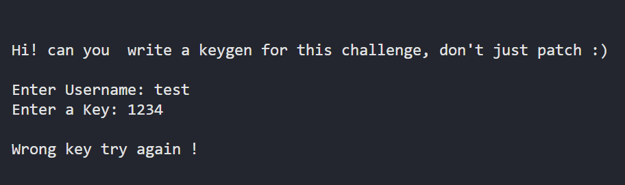
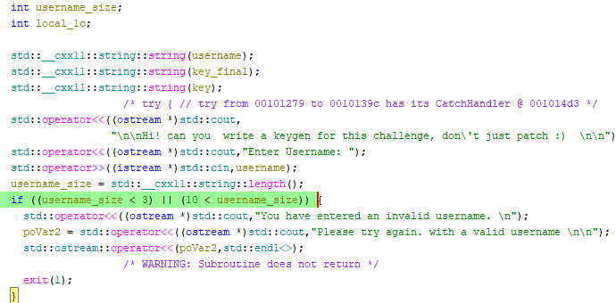
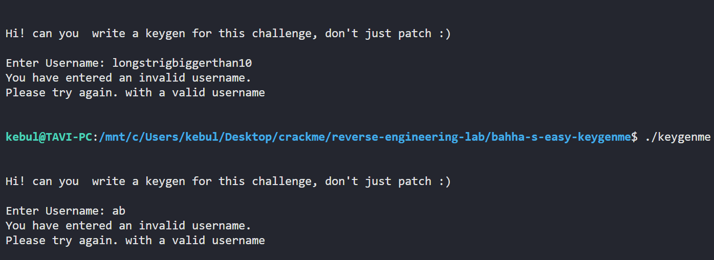
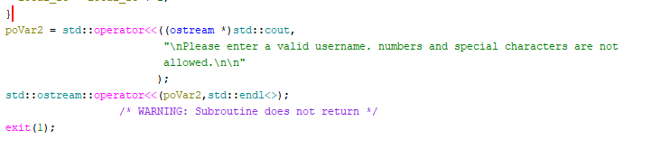
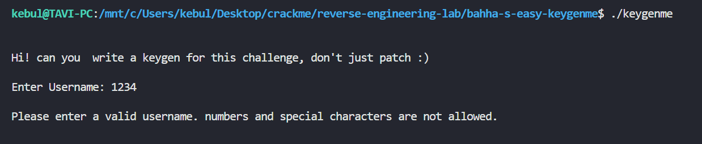
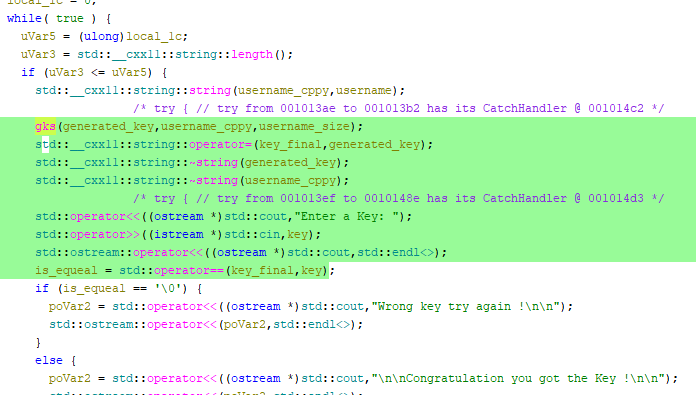
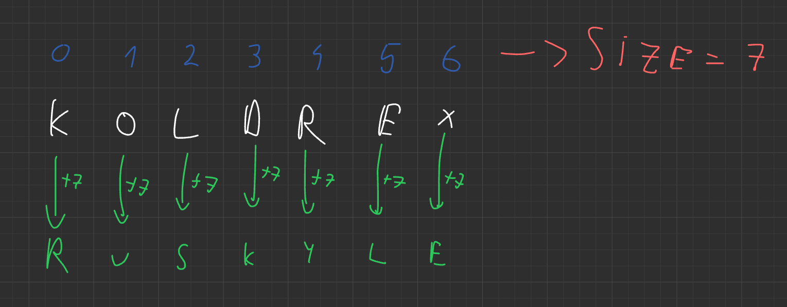
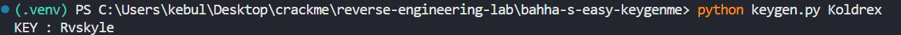
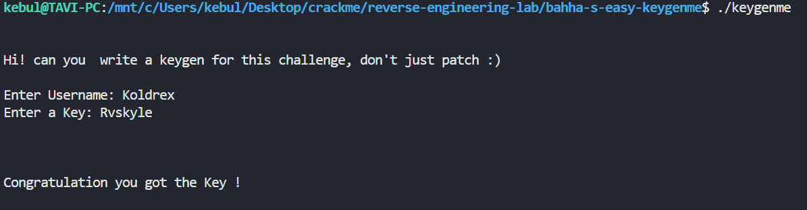

# Writeup: bahha's easy_keygenme

- **Source:** [https://crackmes.one/crackme/5c1cc7d533c5d41e58e005ee](https://crackmes.one/crackme/5c1cc7d533c5d41e58e005ee)
- **Tools:** Ghidra

---

## 1. Static Analysis

### The code reads a username and a password from input



### The main function checks if the username is between *3* and *10* characters long





### At the bottom of the function there is a message that says ***no special characters or numbers are allowed***





### The main function appears to compare `key_final` with `key`

`key_final` -> is actually `generated_key`, the output of the ***gks*** function (returned by reference), whose value is assigned to `key_final`

`key` -> is the key read from the keyboard



## 2. Key Validation Logic

After analyzing the code and renaming the variables, this is the ***gks*** function:

```c

/* gks(std::__cxx11::string, int) */

string * gks(string *key_final,string *username_cppy,int username_size)

{
  int key_final_size;
  int is_alpha_bool;
  char *it;
  undefined1 *puVar1;
  int j;
  int i;
  
  std::__cxx11::string::string(key_final,username_cppy);
  key_final_size = std::__cxx11::string::length();
  for (i = 0; i < key_final_size; i = i + 1) {
                    /* try { // try from 0010156e to 0010162a has its CatchHandler @ 00101645 */
    it = (char *)std::__cxx11::string::operator[]((ulong)key_final);
    is_alpha_bool = isalpha((int)*it);
    if (is_alpha_bool != 0) {
      for (j = 0; j < username_size; j = j + 1) {
        it = (char *)std::__cxx11::string::operator[]((ulong)key_final);
        if (*it == 'z') {
          puVar1 = (undefined1 *)std::__cxx11::string::operator[]((ulong)key_final);
          *puVar1 = 0x61;
        }
        else {
          it = (char *)std::__cxx11::string::operator[]((ulong)key_final);
          if (*it == 'Z') {
            puVar1 = (undefined1 *)std::__cxx11::string::operator[]((ulong)key_final);
            *puVar1 = 0x41;
          }
          else {
            it = (char *)std::__cxx11::string::operator[]((ulong)key_final);
            *it = *it + '\x01';
          }
        }
      }
    }
  }
  return key_final;
}
```
### The function iterates through the string and checks whether each character is a letter (`a` -> `z` or `A` -> `Z`). If it is, the character is replaced with the next letter in the alphabet (`z` wraps around to `a` and `Z` to `A`). This shift is repeated `username_size` times.



## 3. Solution

I created a [Keygen](keygen.py) that adds the size of the string to every char.




