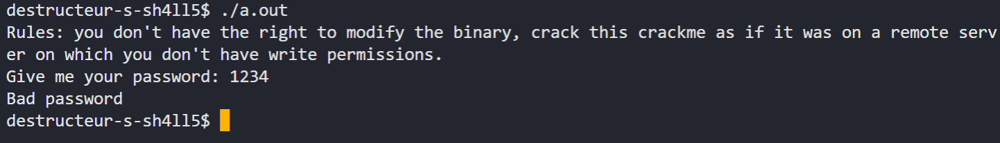
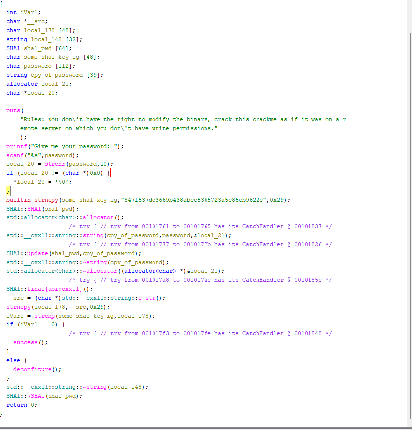
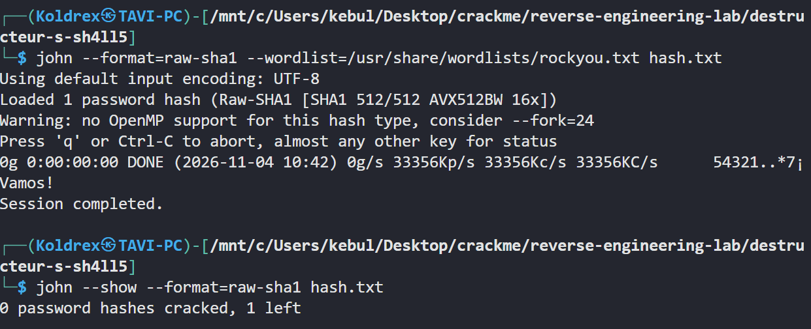
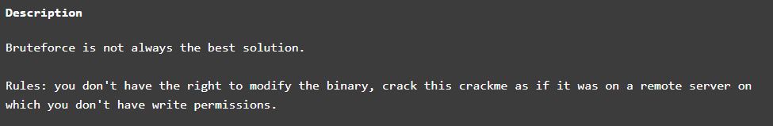
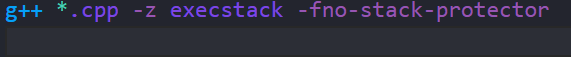
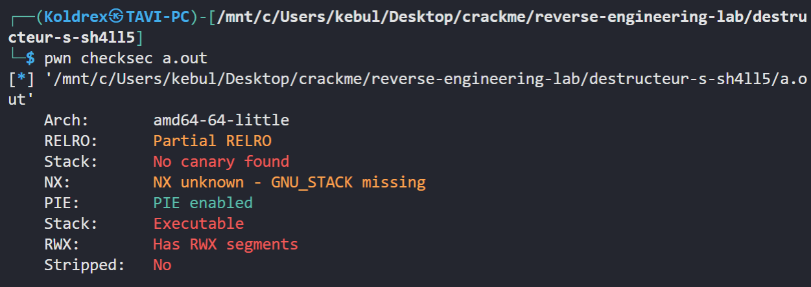
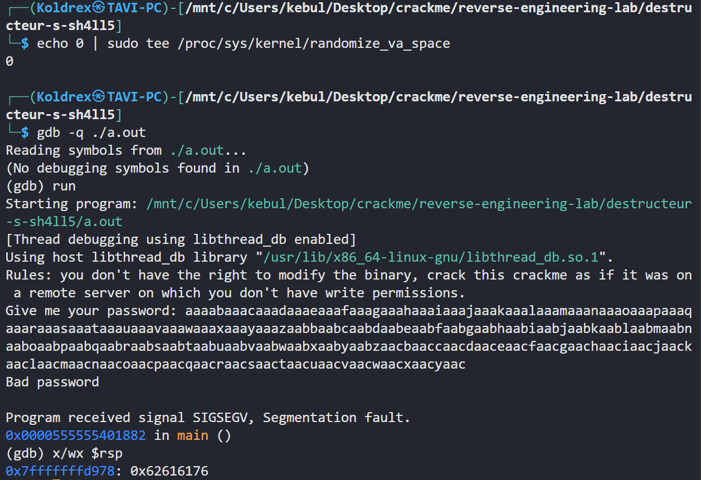
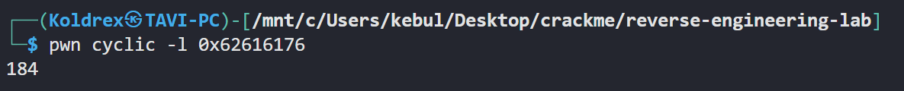
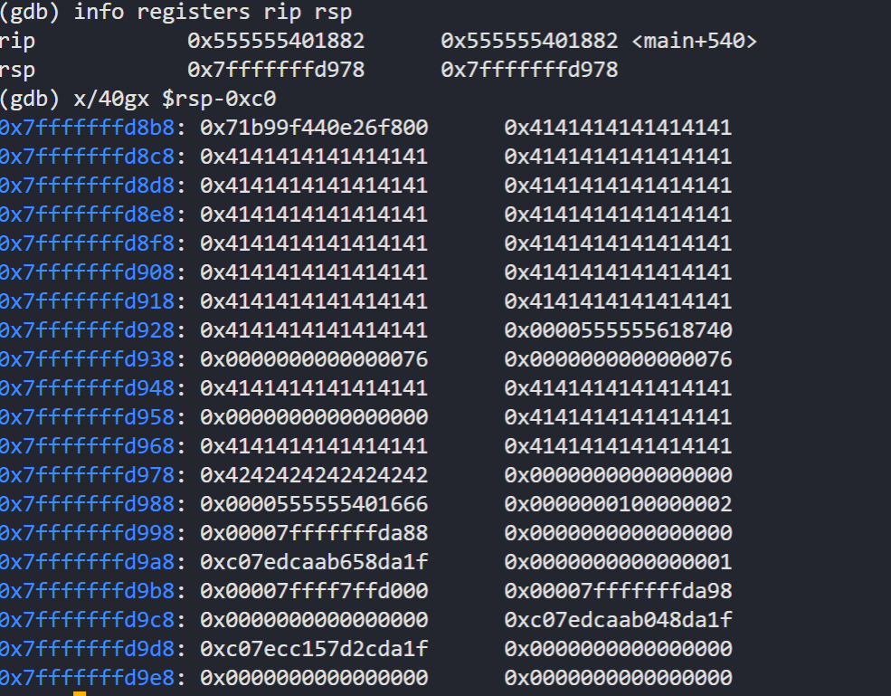
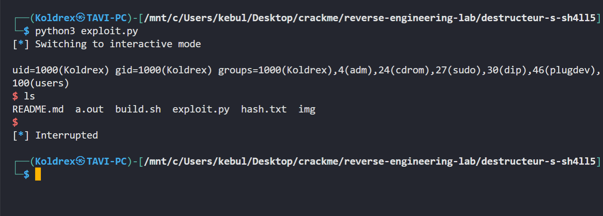

# Writeup: destructeur's Sh4ll5

- **Source:** [https://crackmes.one/crackme/5b1403c633c5d41557b02273](https://crackmes.one/crackme/5b1403c633c5d41557b02273)
- **Tools:** Ghidra

---

## Static Analysis

The main function tests if the `SHA1` key `847f537de3669b438abcc5365723a5c85eb9622c` is the same as the ernterd key. 

We try hasing with bruteforce but realize it does not find the hash.

The author says it's not bruteforce. but the crackme name `Sh4ll5` suggest we have to `get a reverse shell`

`biuld.sh` it's the key

`-fno-stack-protector` -> buffer overflow is not detected

`-z execstack` -> makes the stack executable

Wrote the [Reverse Shell Exploit](exploit.py) and ran it in WSL Kali

