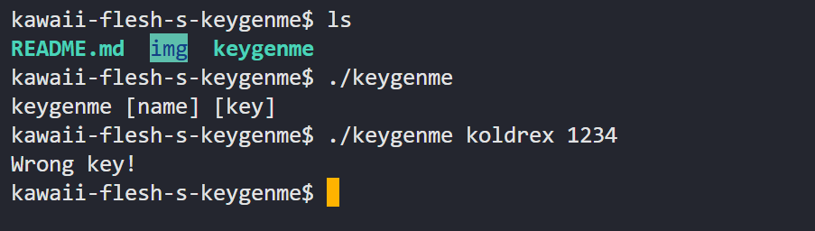
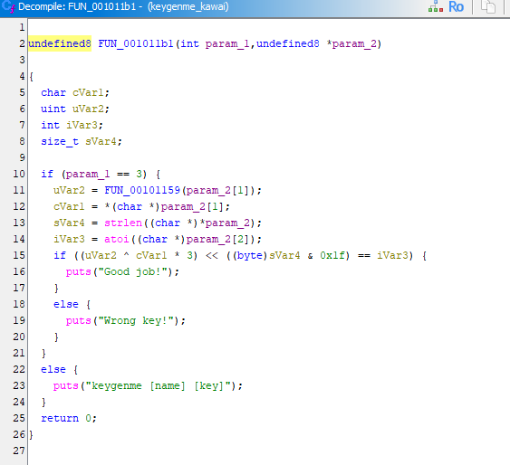
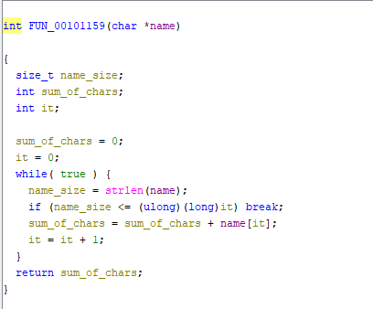
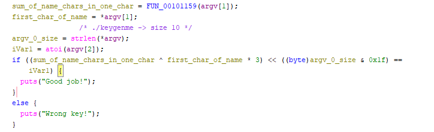
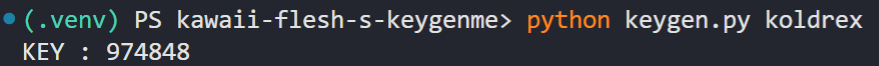
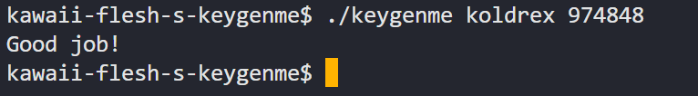

# Writeup: kawaii-flesh's keygenme

- **Source:** [https://crackmes.one/crackme/5d24585133c5d410dc4d0cbd](https://crackmes.one/crackme/5d24585133c5d410dc4d0cbd)
- **Tools:** Ghidra

---

## Static Analysis

### Interesting strings

### Main function

`FUN_00101159` adds up every character of the username and returns the sum as a single value.

## Solution

The key is a simple calculation. I gave the variables descriptive names, so it is easy to follow:

I wrote a [keygen](keygen.py) that takes a name and outputs the matching key:

