# Writeup: paypain's EasyCrack - Much0l0k0

- **Source:** [https://crackmes.one/crackme/5cc1117833c5d4419da558dc](https://crackmes.one/crackme/5cc1117833c5d4419da558dc)
- **Tools:** Ghidra, GDB

---

## Static Analysis

### We got some strings to look around

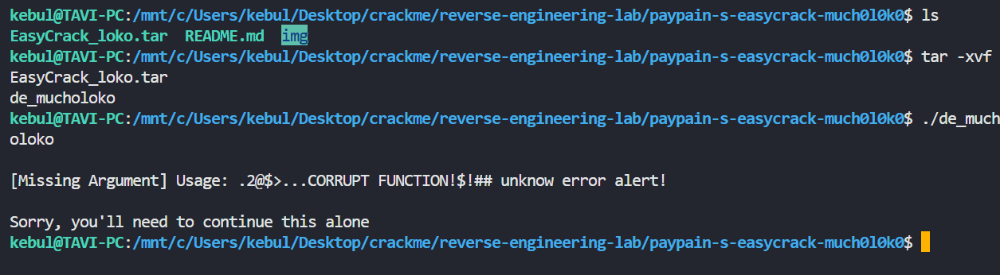

### Searched for strings result

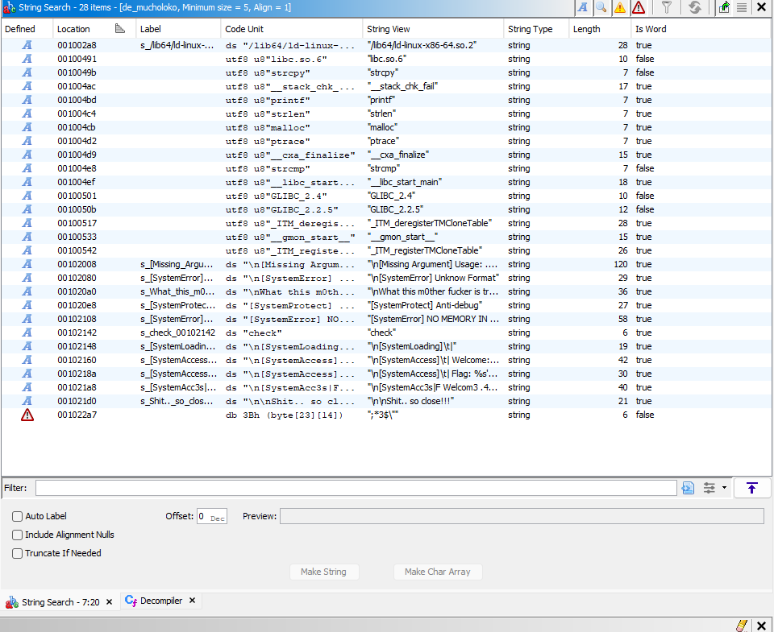

We go to `[Missing Argument] Usage: .2@$>...CORRUPT FUNCTION!$!## unknow error alert!\n\nSorry, you'll need to continue this alone`

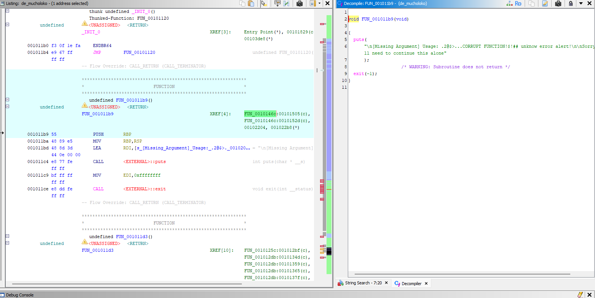

Function `FUN_001011b9` is called by `FUN_0010146c`.

Found main function (`FUN_0010146c`)

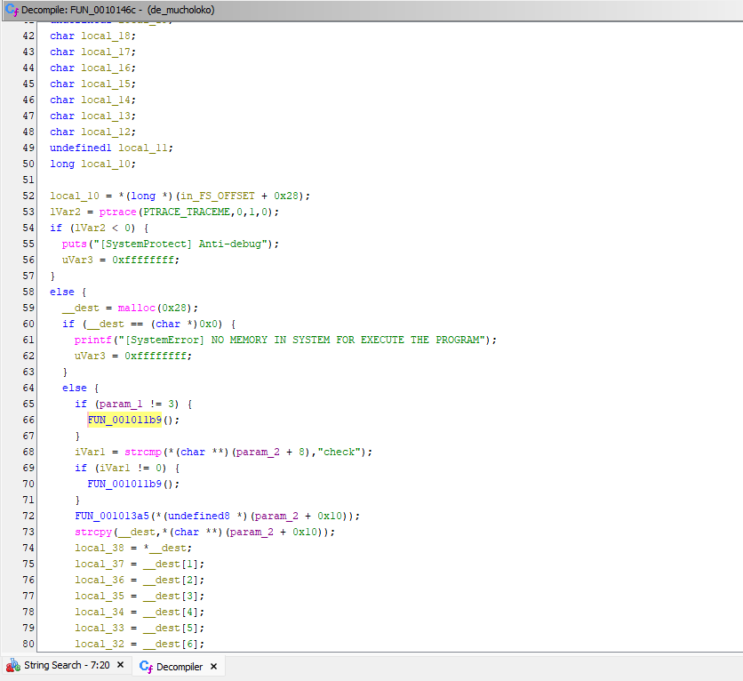

The function has two parameters `param_1` and `param_2`

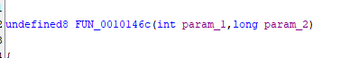

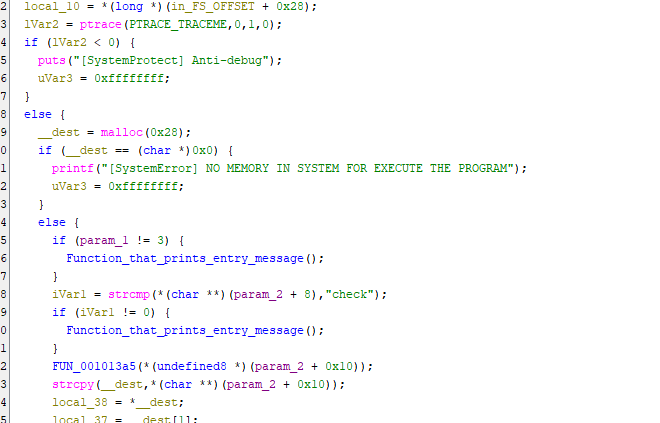

`param_1` -> needs to be exactly 3

`param_2` -> `char **` it's a picture of pointers, skipts the first 8 bytes and cheks if the pointer is "check"

They are surely `int argc` and `char **argv`. The program expects 2 arguments with the first one beeing `check`

Probably `./demucholoko check <key>`

### First parameter is called in `FUN_001013a5`

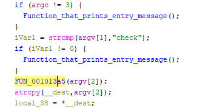
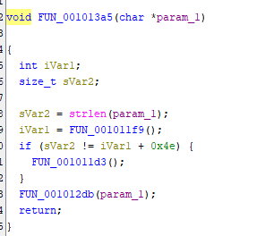
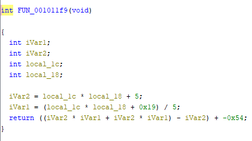

`local_1c` and `local_18` are values left on the stack.

### ***FUN_001013a5***

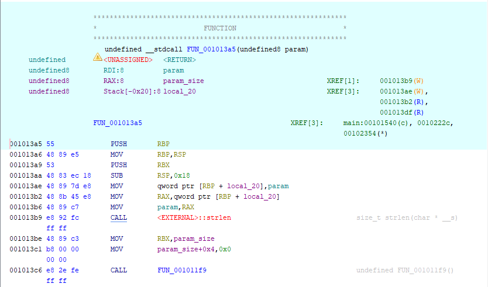

`PUSH RBX` AND `SUB RSP,0X18` -> `RSP = RBP_FUN_001013a5 - 0x20`

`CALL FUN_001011f9` -> `RSP = RBP_FUN_001013a5 - 0x28`

### ***FUN_001011f9***

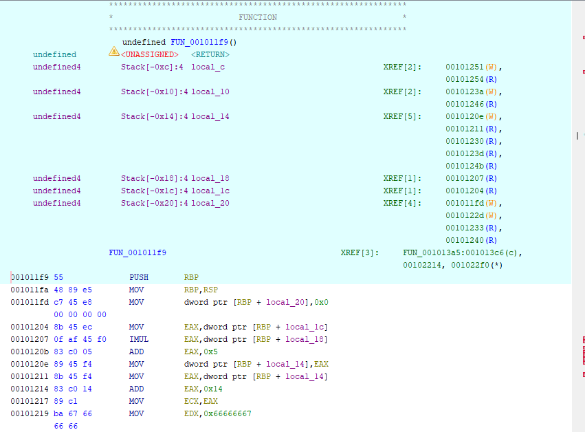

`PUSH RBP` -> `RSP = RBP_FUN_001013a5 - 0x30`

`MOV RBP,RSP` -> `RBP_FUN_001011f9 = RBP_FUN_001013a5 - 0x30`

`local_1c` = `RBP_FUN_001011f9 - 0x1c` = `RBP_FUN_001013a5 - 0x4c`

`local_18` = `RBP_FUN_001011f9 - 0x18` = `RBP_FUN_001013a5 - 0x48`

### DEBUGGING 

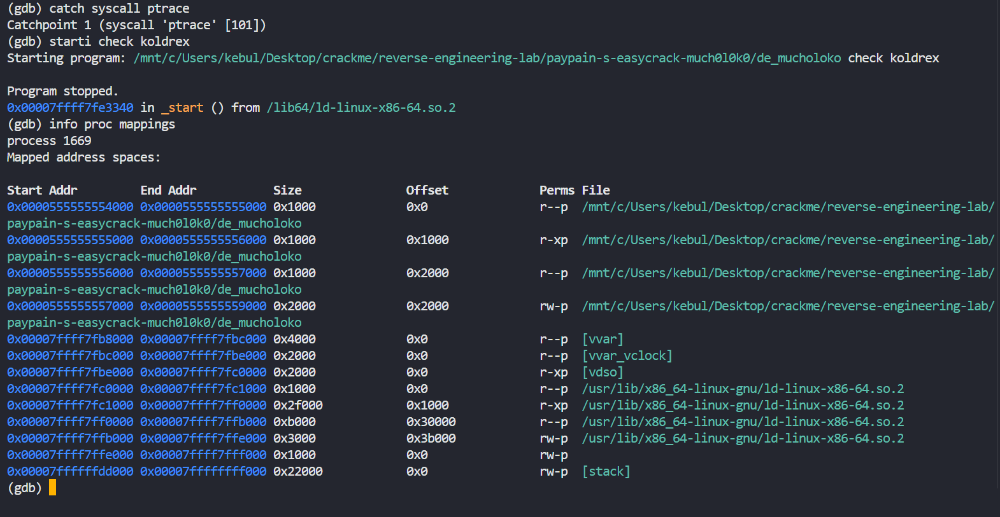

We stop at the entry of ptrace and check mapping to see breakpoint.

`Start Addr` -> `0x0000555555554000`

`FUN_001011f9` -> `0x001011f9` but Ghidra loads image at `0x100000` => The real adress is `0x11f9`

`0x0000555555554000` + `0x11f9` = `0x00005555555551f9`

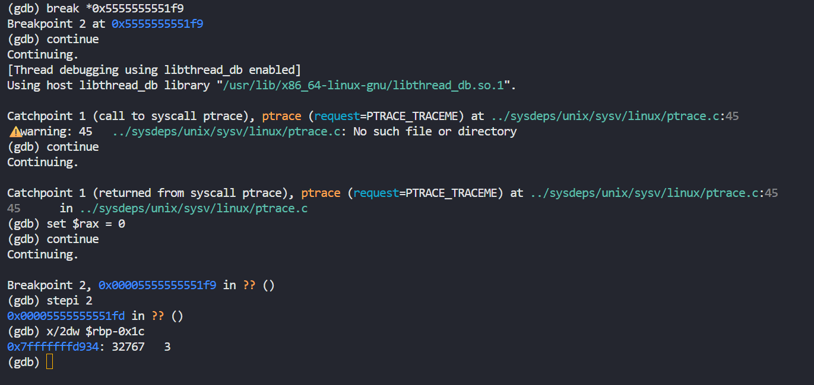

`local_1c` = `32767`

`local_18` = `3`

Now i renamed `FUN_001011f9`'s variables

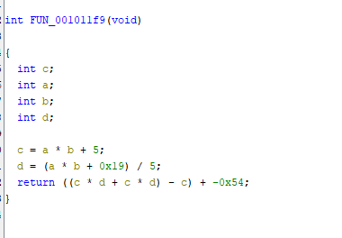


### The realization

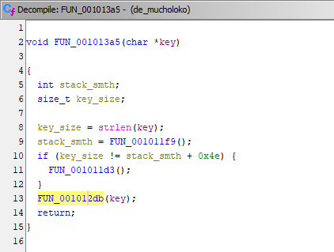

`FUN_0010125c` -> checks if it's in the size limit and than goes to `FUN_001012db`

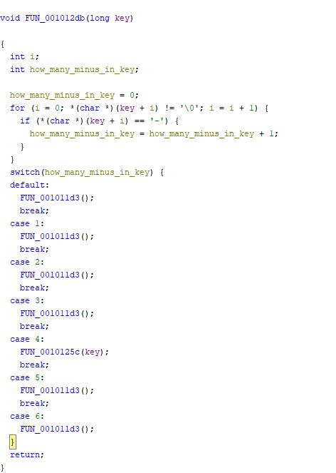

`FUN_0010125c` is th only one with a parameter.

### The 2-nd realization

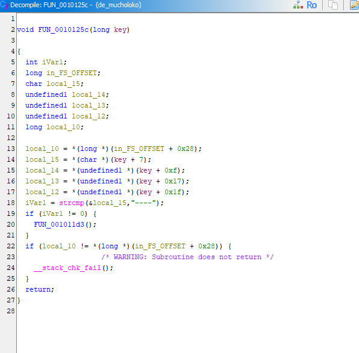

This function cheks to see if the key has the value `-` at positions `0x07`, `0xf`, `0x17`, `0x1f`

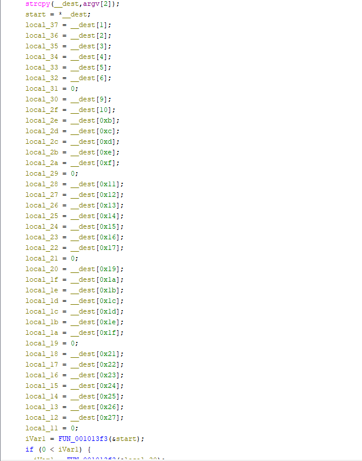

The password is streched upon 5 strings of chars, which are called to pass 5 checks 

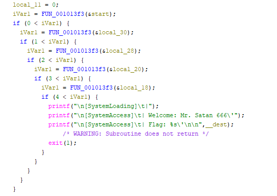

### The `FUN_001013f3` function

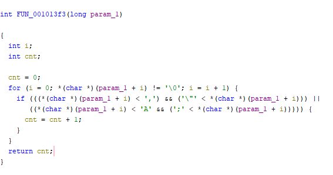

it checks how many char betwwen *`"` and `,`*  OR *`;` and `A`*

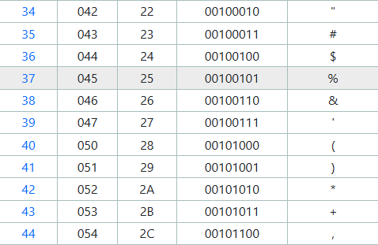
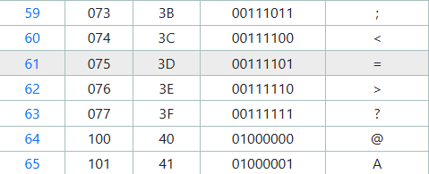

There are 5 strings of 7 chars.

- fist string needs to have at least 1
- second string needs to have at least 2
- third string needs to have at least 3
- forth string needs to have at least 4
- fifth string needs to have at least 5

`local_12 = __dest[0x27]` -> last is `0x27` which is `39` => ***The key has 40 chars***. 

testing 40 chars of `*` with `-` at the correct positions

## Solution

I made a [python script](keygen.py) to correctly generate the key

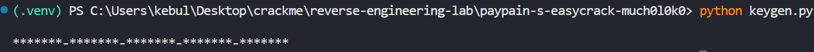

and now we just put the key in `'<key>'` so that bash will now how to read it 

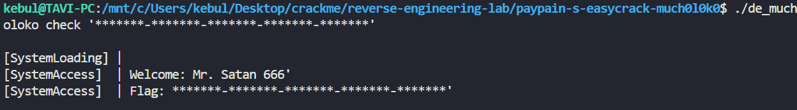